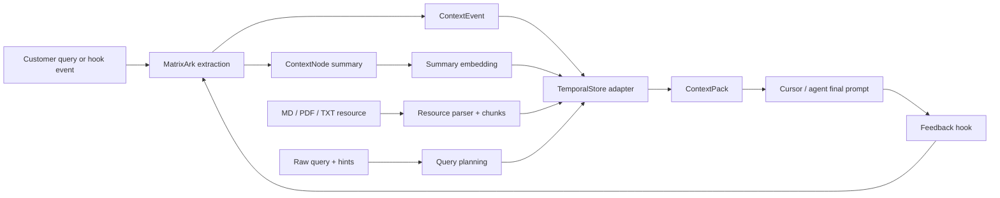

# MatrixArk Context Runtime

This folder is a Python MVP for MatrixArk as an LLM context-management service.
It models the runtime that a vertical Cursor, enterprise agent, or AI harness can call
with a raw user query plus optional hints. MatrixArk extracts the useful temporal
signals, writes lightweight context events, updates summary embeddings, and returns a
token-budgeted context pack.

## License

MatrixArk Context Runtime is open source under the Apache License 2.0.

## Rust Repositories

MatrixArk also publishes the core Rust infrastructure as public open-source repos:

- [TemporalStore](https://github.com/matrixarkai/TemporalStore) - Rust TemporalStore for LLM context management, temporal features, and risk control.
- [matrixcache](https://github.com/matrixarkai/matrixcache) - Rust multi-layer cache system.
- [matrixraft](https://github.com/matrixarkai/matrixraft) - Rust Raft consensus library.

The design follows the practical infrastructure shape we saw in OpenViking-style
systems:

- a model registry that can lazily load open-source embedding or extraction models
- a batchable embedding interface, like a lightweight local version of model-serving recall flows
- a hierarchical context tree instead of a rigid filesystem path
- TemporalStore as the only serving store for events, nodes, chunks, indexes, embeddings, and replay
- resource ingestion for Markdown, PDF, and plain text
- raw resource bytes referenced by URI instead of copied into the serving store

The default implementation is dependency-light and uses deterministic local models so
fast tests run without downloading anything. Docker can run the same flow with
`sentence-transformers/all-MiniLM-L6-v2` for embeddings and `google/flan-t5-small`
as the OSS extraction-model provider. Docker also configures
`Salesforce/blip-image-captioning-base` as the VLM provider path, while local fast
tests use a deterministic VLM stand-in. OpenAI and AI-agent model callbacks can be
added behind the provider interfaces in `matrixark/embeddings.py`,
`matrixark/extraction.py`, and `matrixark/vlm.py`.

## Workflow



## Quick Start

Run the unit tests:

```bash
python -m unittest discover -s matrixark/tests -v
```

Run the sample flow:

```bash
python matrixark/examples/gpu_purchase_flow.py
python matrixark/examples/agent_loop_flow.py
```

Run Docker with open-source embeddings:

```bash
cd matrixark
docker compose build
MATRIXARK_ALLOW_MODEL_DOWNLOAD=1 docker compose run --rm matrixark-test
```

If your Docker install uses the legacy CLI, replace `docker compose` with
`docker-compose`.

## Integration Shape

The customer does not have to define complex schemas. A caller sends:

- `tenant_id`
- raw text from a query, document, tool result, or final answer
- optional hints such as team, project, user, timestamps, token budget, and source

MatrixArk owns the harder work:

- infer time windows and filters
- choose or create a small number of context nodes
- validate API input, prompt budgets, resource paths, and embedding records before
  serving-state writes
- write `ContextEvent` records
- parse `.md`, `.pdf`, and `.txt` resources into stable chunks
- update summary embeddings asynchronously
- store embedding-model and VLM-model embeddings for queries and summaries in
  TemporalStore
- query TemporalStore by scope, time, filters, candidate nodes, and resource chunks
- build replayable `ContextPack` results
- record AI-agent query, final answer feedback, and user confirmation events back into
  TemporalStore

## Real Deployment Adapters

The included adapter is in-memory and testable. A production TemporalStore adapter
should implement the same protocol:

- `TemporalStoreAdapter`: write/query context events, nodes, indexes, dirty summary
  markers, resource documents, resource chunks, summary/chunk embeddings, and
  context-pack audits.

For this MVP, TemporalStore is the only serving store. Raw files are mounted or
referenced by `raw_uri`; parsed serving data and vectors are stored through
TemporalStore methods.

## API Safety

The public Python service raises `MatrixArkValidationError` before storage writes when
required fields are missing, text/query payloads exceed configured bounds, prompt
budgets are invalid, resource paths do not exist, or embedding vectors are malformed.
This keeps the TemporalStore adapter focused on serving-state persistence and prevents
bad agent inputs from becoming replayable context.

## Resource Flow

`ingest_resource()` accepts a `ResourceIngestRequest` with `tenant_id`, `raw_uri`, and
optional hints such as `team`, `project`, and `title`.

- Markdown preserves heading paths.
- PDF extracts page text when `pypdf` is installed, with a plain-text fallback for
  lightweight tests.
- TXT chunks paragraph text.
- Each chunk stores source path, offsets, page or heading metadata, token estimate,
  and an embedding record inside TemporalStore.

## AI-Agent Loop

`MockAiAgentHarness` demonstrates the integration expected from a vertical Cursor or
agent host:

1. The agent sends a raw query through `agent_query()`.
2. MatrixArk records the query as a temporal event and returns a `ContextPack`.
3. The agent calls its LLM using local context plus MatrixArk context.
4. The agent sends the final answer through `agent_final_answer()`.
5. The user sends a second message such as "Yes, that is correct."
6. MatrixArk classifies that second user query as confirmation and stores it through
   `agent_confirmation()`.

The raw query, final answer, and confirmation are injected as TemporalStore events so
future prompts can reuse accepted answers and confirmed memories. Query embeddings and
VLM query embeddings are also persisted in TemporalStore for replay and diagnostics.
