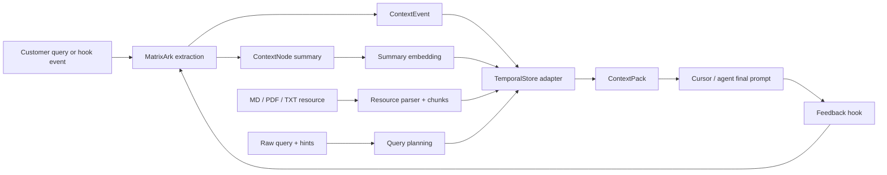

# MatrixArk Context Runtime

The Python home of MatrixArk: context ingestion, retrieval, feedback, and the operator
tooling that runs around them. A caller hands it a raw user query plus optional hints;
it extracts the useful temporal signals, writes lightweight context events, updates
summary embeddings, and returns a token-budgeted context pack.

**Open source under the Apache License 2.0, for anyone in the world to use, fork,
modify and build on.** Issues and pull requests are welcome from everyone — see
[CONTRIBUTING.md](CONTRIBUTING.md).

## The MatrixArk repositories

Everything MatrixArk publishes is public and Apache-2.0:

| repository | language | what it is |
|---|---|---|
| **matrixark** (this one) | Python | the context runtime, the MCP server, the HTTP control plane, the agent hooks and the operator tools |
| [TemporalStore](https://github.com/matrixarkai/TemporalStore) | Rust | the distributed serving engine — context management, long-sequence serving, aggregated feature serving, frequency capping and control state |
| [matrixcache](https://github.com/matrixarkai/matrixcache) | Rust | multi-layer cache |
| [matrixraft](https://github.com/matrixarkai/matrixraft) | Rust | Raft consensus library |

The split is by language, not by product: **all Python lives here, and TemporalStore is
the Rust engine only.** If you are looking for the Python that used to sit in the
TemporalStore tree, it is in this repository, at the same paths.

## Layout

```
matrixark/      the context runtime library: extraction, embeddings, planning, packing
tools/          the MCP server, the HTTP control plane and portal, the agent hooks,
                the validators and test harnesses, and the shell entry points
sdk/python/     the Python SDK
examples/       worked integrations
tests/          the end-to-end suites
```

Installed entry points:

| command | what it starts |
|---|---|
| `matrixark-mcp-server` | the MCP server |
| `matrixark-http-portal` | the HTTP control plane |
| `matrixark-agent-hook` | the agent hook |
| `matrixark-admin` | the admin CLI |
| `matrixark-local-recovery` | local recovery |

## Design

A few decisions shape the whole runtime, and each one is there to keep serving cheap:

- **A model registry that loads lazily**, so a fast test never pays for a model it does
  not use, and a deployment pays once.
- **A batchable embedding interface**, because recall is dominated by how many vectors
  you can embed per call, not by how fast one call returns.
- **A hierarchical context tree rather than a rigid filesystem path**, so a node can be
  created and summarised without inventing a directory layout for it first.
- **One serving store.** Events, nodes, chunks, indexes, embeddings and replay all live
  in TemporalStore; there is no second place for serving state to drift into.
- **Raw bytes referenced by URI, never copied in.** `raw_uri` points at the original;
  only parsed chunks and vectors are stored.
- **Validation before any write**, so a bad agent input fails loudly instead of becoming
  replayable context.

The default implementation is dependency-light and uses deterministic local models, so
the fast tests run without downloading anything. Docker runs the same flow with
`sentence-transformers/all-MiniLM-L6-v2` for embeddings and `google/flan-t5-small` as
the extraction-model provider, and configures
`Salesforce/blip-image-captioning-base` as the VLM provider path; local fast tests use
a deterministic VLM stand-in. OpenAI and AI-agent model callbacks fit behind the
provider interfaces in `matrixark/embeddings.py`, `matrixark/extraction.py` and
`matrixark/vlm.py`.

## Workflow



## Quick start

Run the unit tests:

```bash
python -m unittest discover -s matrixark/tests -v
```

Run a sample flow:

```bash
python matrixark/examples/gpu_purchase_flow.py
python matrixark/examples/agent_loop_flow.py
```

Run Docker with open-source embeddings:

```bash
cd matrixark
docker compose build
MATRIXARK_ALLOW_MODEL_DOWNLOAD=1 docker compose run --rm matrixark-test
```

If your Docker install uses the legacy CLI, replace `docker compose` with
`docker-compose`.

## Integration shape

The caller does not have to define schemas. It sends:

- `tenant_id`
- raw text from a query, document, tool result, or final answer
- optional hints such as team, project, user, timestamps, token budget, and source

MatrixArk owns the harder work:

- infer time windows and filters
- choose or create a small number of context nodes
- validate API input, prompt budgets, resource paths and embedding records before any
  serving-state write
- write `ContextEvent` records
- parse `.md`, `.pdf` and `.txt` resources into stable chunks
- update summary embeddings asynchronously
- store embedding-model and VLM-model vectors for queries and summaries
- query by scope, time, filters, candidate nodes and resource chunks
- build replayable `ContextPack` results
- record agent query, final-answer feedback and user confirmation back as events

## Deployment adapters

The included adapter is in-memory and testable. A production TemporalStore adapter
implements the same protocol — `TemporalStoreAdapter`: write and query context events,
nodes, indexes, dirty summary markers, resource documents, resource chunks, summary
and chunk embeddings, and context-pack audits.

TemporalStore is the only serving store. Raw files are mounted or referenced by
`raw_uri`; parsed serving data and vectors are stored through TemporalStore.

## API safety

The public Python service raises `MatrixArkValidationError` **before** storage writes
when required fields are missing, text or query payloads exceed configured bounds,
prompt budgets are invalid, resource paths do not exist, or embedding vectors are
malformed. That keeps the adapter focused on persistence, and keeps bad agent input
from becoming replayable context.

## Resource flow

`ingest_resource()` takes a `ResourceIngestRequest` with `tenant_id`, `raw_uri` and
optional `team`, `project` and `title` hints.

- Markdown preserves heading paths.
- PDF extracts page text when `pypdf` is installed, with a plain-text fallback for
  lightweight tests.
- TXT chunks paragraph text.
- Every chunk stores its source path, offsets, page or heading metadata, token
  estimate, and an embedding record.

## Agent loop

`MockAiAgentHarness` shows the integration a vertical Cursor or agent host is expected
to make:

1. The agent sends a raw query through `agent_query()`.
2. MatrixArk records it as a temporal event and returns a `ContextPack`.
3. The agent calls its LLM with local context plus that pack.
4. The agent sends the final answer through `agent_final_answer()`.
5. The user replies — say, "Yes, that is correct."
6. MatrixArk classifies that reply as confirmation and stores it through
   `agent_confirmation()`.

Query, final answer and confirmation are all injected as events, so later prompts can
reuse accepted answers and confirmed memories. Query and VLM query embeddings are
persisted too, for replay and diagnostics.

## License

Apache License 2.0 — see [LICENSE](LICENSE).
